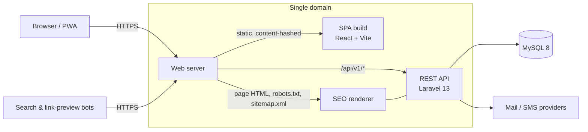

# Architecture

## Components

| Component | Responsibility |
|---|---|
| **SPA** | Public website, customer account area and admin console in one React application. Admin and account areas are code-split and only downloaded when used. |
| **REST API** | Versioned JSON API (`/api/v1`). Public read endpoints for site content; authenticated endpoints for the admin console and customer accounts. |
| **SEO renderer** | Part of the API application. For every page URL it returns the SPA shell with a page-specific `<head>` and the correct status code. See [SEO & Performance](SEO-PERFORMANCE.md). |
| **MySQL** | Single source of truth for content, users, roles, orders and audit logs. |

## Request flow

1. **Page request** (`/services/enterprise-systems`): the web server routes it to the SEO renderer, which looks up the published record and returns `index.html` with that page's title, description, canonical URL, social tags and structured data. An unknown slug returns `404`.
2. The browser loads the content-hashed JavaScript (cached for a year) and the React app takes over routing.
3. **Data** is fetched from `/api/v1/*` with TanStack Query (cached client-side, network-first in the service worker for public content only).
4. **Admin actions** use the same API, authenticated with an HTTP-only session cookie and protected by CSRF tokens and per-permission authorization.

## API design

- Resource-oriented, versioned under `/api/v1`; public, admin (`/api/v1/admin`) and customer (`/api/v1/client`) areas are separated by route group.
- Responses are shaped by API Resources, so internal columns are never serialized by accident.
- Validation happens in Form Requests at the edge; controllers stay thin.
- Writes to sensitive data are recorded in an audit log (actor, action, before/after, IP).

## Authorization model

- **Roles** (e.g. super-admin, admin, editor, HR manager) hold **permissions** expressed as slugs such as `news.create` or `applications.view`.
- Every admin route declares the permission it needs; super-admin bypasses checks.
- Customers authenticate separately from staff, with an isolated guard and rate-limit namespace.

## Deployment topology

- Single domain over HTTPS (HSTS), canonical non-`www` host.
- The SPA is deployed as static files; the API and SEO renderer run on PHP-FPM/LiteSpeed.
- Secrets live only in server-side environment files, never in the repository or the client bundle.
- CI runs backend tests on MySQL, frontend type-check, lint and build, dependency audits and a secret scan on every change.

## Roadmap

The platform is evolving toward an ERP: finance, client deployments and a digital library with author payouts are already in place; the remaining legacy admin module is being retired in favour of the unified admin console.
